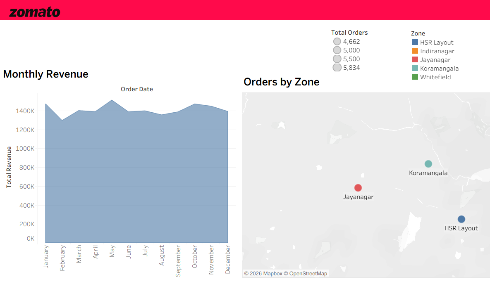
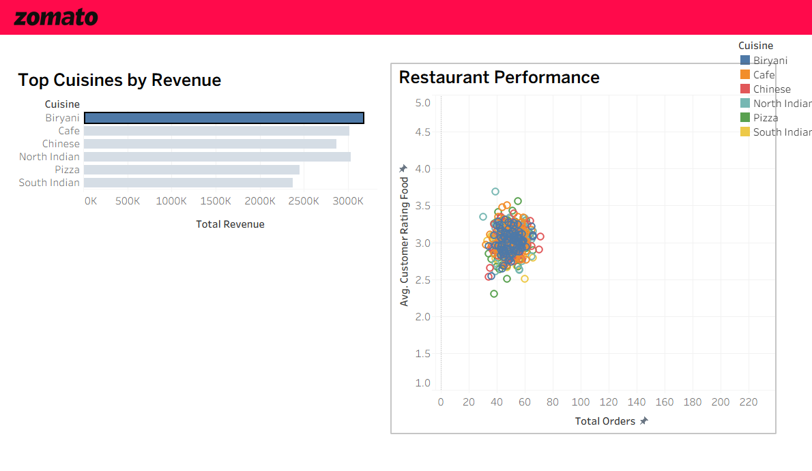
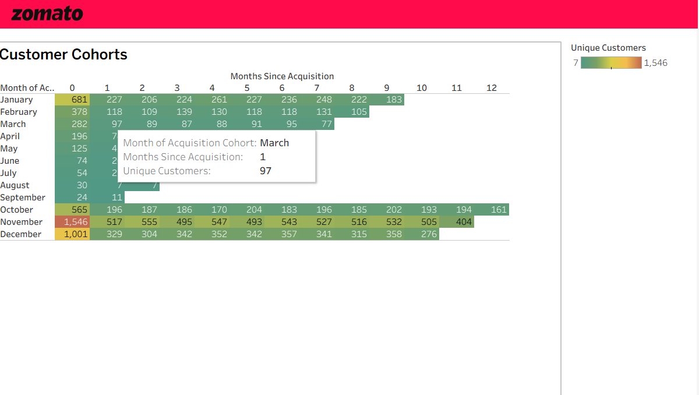
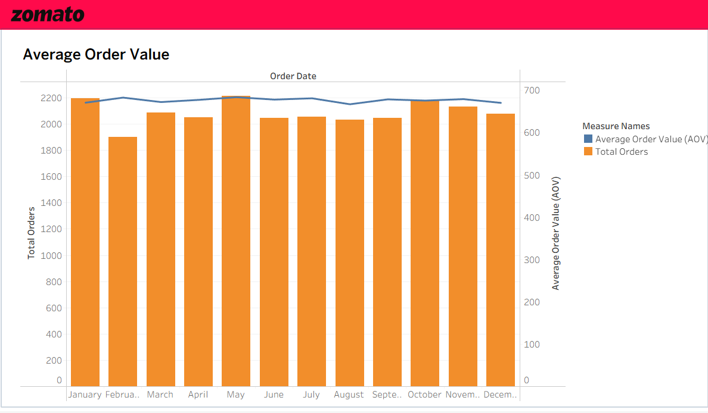

# Zomato BI Dashboard

A small practice project: fake Zomato-style order data goes into PostgreSQL, a SQL step turns it
into one flat table, and a Tableau workbook reads that table and draws four dashboards. A Python
script does the middle part, and Windows Task Scheduler can run it every morning.

None of the data is real. It's randomly generated, which is why the charts look fairly flat.

## What it looks like

| Overview | Restaurants |
|---|---|
|  |  |

| Customer cohorts | Orders vs average order value |
|---|---|
|  |  |

## How it fits together

1. `src/generate_data.py` makes 5,000 customers, 500 restaurants and 25,000 orders as CSV files in `data/`.
2. `src/run_pipeline.py` runs the whole thing: it calls the generator, creates the raw tables if they
   don't exist, empties them, loads the CSVs, then rebuilds `mart_performance` (all the SQL is in `sql/`).
3. The same script writes the finished table out to `data/zomato_mart.csv`.
4. `Zomato_Db.twb` reads that CSV.

The database work in step 2 (create, empty, load, rebuild, export) runs in one transaction, so
if something fails halfway the database is left as it was. Raw tables are always reloaded
before the mart is rebuilt.

## Running it

You need PostgreSQL and Python 3.10 or newer.

```bash
pip install -r requirements.txt
```

Copy `.env.example` to `.env` and put in your own database details. `.env` is in `.gitignore`,
so it won't get committed. Create an empty database called `zomato_db`, then:

```bash
python src/run_pipeline.py
```

Progress is printed and also written to `logs/pipeline.log`.

On Windows, use `127.0.0.1` rather than `localhost` for `DB_HOST` if you get a connection error.
`localhost` can resolve to IPv6, and the default Postgres setup often only allows IPv4 locally.

## Opening the Tableau workbook

The workbook stores the path to the CSV from the machine it was made on, so it won't find the
file after you clone this. Run the pipeline once so `data/zomato_mart.csv` exists, open the
workbook, and in *Data > Edit Data Source* point it at your copy.

I used Tableau Public (the free desktop version). It can only connect to files, not to a
database like Postgres, which is why the pipeline exports a CSV. It also has no scheduled
refresh, so after the pipeline runs you refresh the data yourself in Tableau (*Data > Refresh*).

The map uses `zone_lat` / `zone_lng` columns from the data. Tableau couldn't place Bengaluru
neighbourhood names like "Jayanagar" on its own.

## Running it every morning

`register_task.ps1` creates a Windows scheduled task called `ZomatoBIPipeline` that runs the
pipeline at 05:00. Open PowerShell as Administrator (the title bar should say
"Administrator: Windows PowerShell"), then:

```powershell
cd path\to\this\folder
.\register_task.ps1
```

To try it straight away instead of waiting until 5 AM:

```powershell
Start-ScheduledTask -TaskName 'ZomatoBIPipeline'
```

Two things to know:
- The script has my Python path written into it (`C:\Users\deipt\AppData\Local\Programs\Python\Python313\python.exe`).
  Change the `$Python` line to wherever your `python.exe` is.
- The task is allowed to start and keep running on battery, so a laptop doesn't skip a run.

## Files

```
data/                  generated CSVs (not committed)
logs/                  pipeline.log (not committed)
sql/
  00_create_raw_tables.sql
  01_load_raw.sql
  02_build_mart.sql
src/
  generate_data.py
  run_pipeline.py
assets/                dashboard screenshots
Zomato_Db.twb          the Tableau workbook
register_task.ps1      sets up the daily task
.env.example           template for your database settings
requirements.txt
```

## Built with

PostgreSQL, Python (pandas, Faker, psycopg2), Windows Task Scheduler, Tableau Public.
